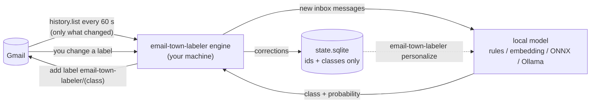

# email-town-labeler

**Self-hosted Gmail auto-labeling with a small model that runs on your own machine.**

email-town-labeler watches your Gmail inbox, classifies each new message with a local model, and adds a
label such as `email-town-labeler/action needed` or `email-town-labeler/newsletters`. It never archives, deletes
or marks anything read. You decide what to do with the labels: filters, search, or just
scanning the sidebar.

[](https://github.com/scamai/email-town-labeler/actions/workflows/ci.yml)
[](LICENSE)


## Why

Hosted inbox-sorting services work by sending your mail to their servers. email-town-labeler does not.

- **Your mail never leaves your machine.** email-town-labeler talks only to the Gmail API (Google already
  has your mail) and, if you ask for one, downloads a model file. The model runs locally.
- **Your own OAuth client.** You create the Google OAuth client in your own Google Cloud
  project. There is no email-town-labeler server and no shared app that could be compromised.
- **No telemetry.** No analytics, no crash reports, no update checks.
- **Nothing about content is stored.** The local database holds message ids, predicted
  classes and your corrections. Logs never contain subjects, senders or bodies.
- **Non-destructive and reversible.** It only adds and removes its own `email-town-labeler/...` labels.
  `email-town-labeler undo` removes all of them.

Details: [docs/privacy.md](docs/privacy.md).

## How it works



1. Every ~60 seconds email-town-labeler asks Gmail what changed since the last poll.
2. New inbox messages are fetched, rendered to a short text (sender, subject, list headers,
   start of the body) in memory, and classified by the local model.
3. A labeling policy turns the model's probabilities into one `email-town-labeler/<class>` label: it
   leans towards `action needed`, keeps uncertain mail and people you write to out of
   `promotional`, and marks Primary mail from strangers as `new sender`.
4. If you move a message to a different `email-town-labeler/...` label or remove ours, that is recorded
   as a correction. `email-town-labeler personalize` uses your corrections to adapt the model, locally.

## Quickstart

Requires Python 3.10+ on macOS, Linux or Windows, and a Gmail or Google Workspace account.

> **Not on PyPI.** The name `email-town-labeler` on PyPI belongs to an unrelated project and the final
> package name is not decided yet. Install from GitHub as shown below; **do not
> `pip install email-town-labeler`**.

1. **Install** from GitHub, with the `onnx` extra the default model needs

   ```bash
   pipx install "email-town-labeler[onnx] @ git+https://github.com/scamai/email-town-labeler"
   ```

   ([pipx](https://pipx.pypa.io) keeps it in its own environment. In a virtualenv,
   `pip install "email-town-labeler[onnx] @ git+https://github.com/scamai/email-town-labeler"`
   works too, as does `uv tool install` with the same argument. Without `[onnx]` you get the
   dependency-free `rules` model only.)

2. **Create a Google OAuth client** (one time, about 10 minutes). Follow
   [docs/google-cloud-setup.md](docs/google-cloud-setup.md), or print the gcloud commands for
   the scriptable part and the console links for the rest:

   ```bash
   email-town-labeler gcp-setup --print --project my-email-town-labeler   # prints the gcloud commands to paste
   ```

   (From a clone of this repository, `scripts/gcp_setup.sh` on macOS / Linux or
   `scripts\gcp_setup.ps1` on Windows runs those commands for you. The scripts are not part
   of the installed package.)

   You end up with a downloaded `client_secret_....json` for a **Desktop app** client.

   Personal Gmail users: read [step 4](docs/google-cloud-setup.md#4-audience-testing-vs-production-external-only)
   of the guide. In Google's default "Testing" mode, logins expire every 7 days.

3. **Set up**

   ```bash
   email-town-labeler setup
   ```

   The wizard asks for the client JSON, opens Google's consent page, offers the default model
   [`town-modernbert`](#models) and downloads it (about 820 MB, once; the archive's sha256 is
   pinned), and shows a dry run on your 5 newest messages (class and confidence per message id;
   nothing is changed).

4. **Run it in the background**

   ```bash
   email-town-labeler service install
   ```

   This registers `email-town-labeler run` with launchd (macOS), systemd `--user` (Linux) or Task
   Scheduler (Windows).

5. **Done.** New mail gets labeled within a minute. Check on it with `email-town-labeler status`.
   Want your existing inbox labeled too? `email-town-labeler backfill --days 30`.

## Docker

For servers and home labs. All state lives in the `/data` volume; the container runs as a
non-root user and exposes no ports.

```bash
git clone https://github.com/scamai/email-town-labeler && cd email-town-labeler/docker
docker compose build                                 # includes the onnx extra; EXTRAS=embed,onnx adds torch

# copy your OAuth client JSON into the volume
docker compose run --rm -T --entrypoint sh email-town-labeler \
  -c 'mkdir -p /data/config && cat > /data/config/client_secret.json' < ~/Downloads/client_secret_XXXX.json

# sign in without a browser in the container (open the printed URL anywhere, approve, and
# paste back the http://localhost/... URL you land on), download the default model into the
# volume, and dry-run it on your 5 newest messages
docker compose run --rm email-town-labeler setup --headless --model town-modernbert

docker compose up -d
docker compose logs -f
```

Once releases are published, the image will also be available as `ghcr.io/scamai/email-town-labeler`
(`:latest`, `:X.Y.Z`, and `-embed` variants).

The image's healthcheck runs `email-town-labeler status --json`, which exits non-zero when there is no
token, when no poll has succeeded yet 15 minutes after setup, or when the last successful poll
is older than `max(10 x poll_seconds, 15 min)`. The container reports `unhealthy` until you
have logged in.

## Commands

| Command | What it does |
|---|---|
| `email-town-labeler setup` | Guided first-time setup: client secret, login, model, dry run, optional service install |
| `email-town-labeler login [--headless]` | (Re)authorize Gmail access. `--headless` for machines without a browser |
| `email-town-labeler run` | Run the labeler in the foreground, polling every `poll_seconds` |
| `email-town-labeler once` | Do a single poll and exit (good for cron or testing) |
| `email-town-labeler backfill [--days N] [--limit N] [--dry-run]` | Classify mail already in your inbox (default: last 7 days) |
| `email-town-labeler status [--json] [--redact]` | Account, model, last poll, counts per class, service state. Exits 1 when unhealthy. `--redact` masks your address and home paths |
| `email-town-labeler undo [--dry-run]` | Remove every `email-town-labeler/...` label from every message. Touches nothing else |
| `email-town-labeler model list` | Published models (installed or not, with sizes), installed packages, and the active one |
| `email-town-labeler model pull <name\|ref> [--use]` | Download and verify a model package (`town-modernbert`, `hf:...`, a URL); `--use` makes it active |
| `email-town-labeler model info [ref]` | Manifest, license and metrics of a model (default: the active one) |
| `email-town-labeler personalize [--strength X]` | Adapt the active model to your corrections, locally |
| `email-town-labeler contacts rebuild \| count [--json]` | Rescan sent mail for the addresses you write to (headers only) / show how many are stored. `contacts list --yes-show-addresses` is the only command that prints them |
| `email-town-labeler service install \| uninstall \| status` | Manage the background service |
| `email-town-labeler doctor [--redact]` | Check config, token, scopes, Gmail access, model, labels |
| `email-town-labeler gcp-setup --print [--project ID]` | Print the gcloud commands that prepare a Google Cloud project (runs nothing) |
| `email-town-labeler --version` | Print the version |

Global options, before or after the command: `--home DIR` (same as `EMAIL_TOWN_LABELER_HOME`), `-v` /
`-vv` for more logging. Exit codes: `0` success, `1` error, `2` usage error. Only one `run`,
`once`, `backfill` or `undo` runs per data directory at a time; a second exits with `1`.

## Labels

| Label in Gmail | Applied to |
|---|---|
| `email-town-labeler/action needed` | mail that asks you to do something: reply, approve, pay, sign, review, decide |
| `email-town-labeler/newsletters` | newsletters, digests and blog posts you subscribed to |
| `email-town-labeler/promotional` | marketing, sales outreach, promotional offers |
| `email-town-labeler/orders` | receipts, invoices, order confirmations, shipping updates |
| `email-town-labeler/travel` | flights, hotels, rentals, itineraries, check-in notices |
| `email-town-labeler/updates` | automated notifications: account, security, status changes |
| `email-town-labeler/new sender` | Primary-tab mail that fits none of the above, from an address you have never sent mail to (`[policy] new_sender`) |
| `email-town-labeler/unknown` | low-confidence or "none of the above"; only if `unknown_action = "label"` |

At most one email-town-labeler label per message. Which one is decided by a policy you can tune in
`[policy]` (see [configuration.md](docs/configuration.md#policy)): `action needed` as soon as
the model gives it 20 %, `promotional` only above 60 % and never for people you have written
to (built-in defaults; a model can recommend its own, and `town-modernbert` uses 7 % and
80 %). Rename them under `[labels]` in the config, or
change the `email-town-labeler` prefix with `label_prefix`.

## Configuration

`email-town-labeler setup` writes `config.toml`; the defaults are sensible:

```toml
[gmail]
label_prefix = "email-town-labeler"
poll_seconds = 60
skip_label_names = []        # never touch mail with these labels

[model]
ref = "town-modernbert"      # or "rules": no ML dependencies, no download
min_confidence = 0.55        # below this: "unknown"
unknown_action = "skip"      # or "label"
device = "cpu"

[engine]
dry_run = false              # true: classify and record, never change Gmail

[policy]
# action_threshold = 0.2     # lower: more "action needed" (fewer missed, more false alarms)
# promotional_threshold = 0.6  # higher: less uncertain mail filed under "promotional"
#   left unset, these two come from the model (town-modernbert: 0.07 and 0.8)
protect_known_contacts = true
new_sender = true
```

File locations per OS, every key, and `EMAIL_TOWN_LABELER_HOME`: [docs/configuration.md](docs/configuration.md).

## Models

### The default: `town-modernbert`

`email-town-labeler setup` offers it, or get it any time with:

```bash
email-town-labeler model pull town-modernbert --use
```

- **What it is:** ModernBERT-large fine-tuned to pick one of the seven classes, exported to
  ONNX so it runs without PyTorch (needs the `[onnx]` extra). An 824 MB download from the
  [v0.1.0 release](https://github.com/scamai/email-town-labeler/releases/tag/v0.1.0); the
  archive's sha256 is pinned in the code and every file is checked against its manifest.
  `town-modernbert-torch` is the same model as PyTorch weights (635 MB, `[embed]` extra).
- **What it was trained on:** 4,176 inbound emails from **one person's Gmail inbox** (English,
  July–October 2026), labeled by a hosted auto-labeling tool's six content labels. The mailbox
  owner consented to publishing the weights. Fine-tuned models can memorise fragments of their
  training data (names, senders, subject lines). The labels reflect one person's inbox and one
  tool's taxonomy, so expect it to fit your mail less well than it fits theirs. Read the
  [model card](docs/model-cards/town-modernbert.md) and [privacy.md](docs/privacy.md#the-published-model-and-whose-mail-it-learned-from).
- **Speed:** on a CPU with 6 threads, about 0.2–0.3 s per email.
- **Held-out numbers (from the model card):** a copy trained on half the emails (2,075, split by
  thread) and scored on the other half (2,101): **7-way accuracy 87.3%** (95% CI 85.9–88.8),
  macro-F1 0.807 over the 5 classes with at least 20 test emails. With the recommended policy
  (action needed at ≥0.07, promotional only at ≥0.8), **action-needed recall 0.88** (precision
  0.41), promotional precision 0.82, accuracy 84.3%. The published weights were then retrained
  on all 4,176 emails, so these numbers describe the method, not a held-out test of the exact
  weights, and they measure agreement with one inbox's labels, not with yours.

The model ships recommended thresholds (`action_threshold = 0.07`,
`promotional_threshold = 0.8`); they apply unless you set those keys in `config.toml`.
`email-town-labeler status` shows the values in effect and where they come from.

### Backends

The model is a plug-in: a directory with a `model.json` manifest and its files, run by one of
the built-in backends.

| Backend | Install | Notes |
|---|---|---|
| `rules` | included | Heuristics over Gmail's categories and mail headers. No ML dependencies, no download. The fallback when the `[onnx]` extra is missing. |
| `embedding_probe` | `pipx install --force "email-town-labeler[embed] @ git+https://github.com/scamai/email-town-labeler"` | Sentence-transformers embedder + small linear head. Personalizable. |
| `onnx_classifier` | `pipx install --force "email-town-labeler[onnx] @ git+https://github.com/scamai/email-town-labeler"` | ONNX encoder + linear head, no torch. Personalizable. |
| `hf_sequence_classifier` | `pipx install --force "email-town-labeler[embed] @ git+https://github.com/scamai/email-town-labeler"` | A fine-tuned transformers classifier (BERT, ModernBERT, ...) shipped inside the package (`town-modernbert-torch`). |
| `onnx_sequence_classifier` | `pipx install --force "email-town-labeler[onnx] @ git+https://github.com/scamai/email-town-labeler"` | The same classifier as one ONNX graph, no torch (`town-modernbert`). |
| `ollama_choice` | a running [Ollama](https://ollama.com) | Asks a local LLM. No training needed; slower. |

```bash
email-town-labeler model list                       # published models, installed packages, the active one
email-town-labeler model pull hf:ORG/REPO@REVISION  # or a local directory, or an https .tar.gz
```

Then set `[model] ref` to the package name and restart the service. How models are packaged,
evaluated and accepted: [docs/models.md](docs/models.md).

## Learning from your corrections

Fix labels in Gmail the way you normally would: remove the email-town-labeler label, or swap it for
the right `email-town-labeler/...` one. email-town-labeler records each correction (ids and class names only).
Then:

```bash
email-town-labeler personalize
```

This re-fetches the corrected messages from Gmail, refits the model's small classifier head on
your machine (anchored to the original so a few corrections don't overwrite it), saves it as
`<model>-personal`, and switches to it (restart the service to load it). It needs at least 5
corrections and works with `embedding_probe` and `onnx_classifier`.
The personalized model is derived from your mail: keep it private.

## Undo

```bash
email-town-labeler service uninstall   # stop the background labeler
email-town-labeler undo                # remove every email-town-labeler/... label; nothing else is touched
```

Then revoke access at <https://myaccount.google.com/permissions> and delete the config and
data directories (see [docs/configuration.md](docs/configuration.md#files-and-directories)).

## FAQ

**Does email-town-labeler send my email anywhere?**
No. It reads mail from the Gmail API and classifies it in-process. The only other network
traffic is a model download you ask for. The `ollama_choice` backend sends text to an Ollama
server, and only on this machine (`localhost`) unless you opt in with
`[model] allow_remote_endpoint = true`; a model package cannot change that
([details](docs/privacy.md#model-endpoints)).

**Why do I need my own Google Cloud project?**
So that nobody else's app holds a token to your mailbox. It also means email-town-labeler has no
server-side component that could leak or be shut down.

**Why does Google say the app is unverified, or "unsafe"?**
Because it is your own app and Google hasn't reviewed it. Verification is meant for apps
distributed to the public. You are the developer here.
[Details](docs/google-cloud-setup.md#4-audience-testing-vs-production-external-only).

**Why does the consent screen say it can read, send and compose mail?**
That is Google's description of the `gmail.modify` scope, the narrowest scope that allows
both reading a message and changing its labels. email-town-labeler only adds and removes its own
labels; [here is exactly what it does](docs/privacy.md#what-gmailmodify-allows-and-what-email-town-labeler-does).

**What happens if my laptop sleeps or is off?**
On the next poll email-town-labeler picks up everything that changed while it was away. If it was away
so long that Gmail no longer has that history, it scans inbox mail received since its last
successful poll instead (at most 30 days back, configurable, and never mail from before you
set it up).

**Does it label mail that was already there?**
Only if you run `email-town-labeler backfill`. A backfill is limited by Gmail's API quota to roughly
5,000 messages an hour.

**Can I use it with several accounts?**
Yes: one instance per account, each with its own `EMAIL_TOWN_LABELER_HOME` (or its own Docker volume).

**Does it work with Outlook, IMAP or Fastmail?**
No. Gmail and Google Workspace only, through the Gmail API.

**Does it need a GPU?**
No. Everything targets CPU. `device = "cuda"` is available for the embedding and ONNX
backends.

**What does it cost?**
Nothing. The Gmail API is free at this usage level, and one mailbox stays far below Google's
per-project limits ([numbers](docs/google-cloud-setup.md#quota)).

## Limitations

- Gmail and Google Workspace only.
- Polling, not push: labels appear within about `poll_seconds` of arrival. Push via Pub/Sub
  would need a Google Cloud Pub/Sub topic and is not implemented.
- One label per message from a fixed set of seven classes (plus the rule-based `new sender`).
- The default model `town-modernbert` learned from one person's inbox; on yours it will make
  more mistakes than its published numbers suggest, and it needs about 820 MB of disk and the
  `[onnx]` extra. `rules` is a heuristic baseline with limited quality.
- `personalize` does not work with `town-modernbert` (a sequence classifier has no separate
  head to refit); your corrections are still recorded.
- Personal Gmail with an app in "Testing" status must log in again every 7 days.
- `personalize` needs an `embedding_probe` or `onnx_classifier` model and some corrections per class.
- Only new inbox mail is labeled automatically; archived mail and other folders are ignored.

## Documentation

- [Google Cloud setup](docs/google-cloud-setup.md): OAuth client, consent screen, token expiry, quota
- [Privacy and threat model](docs/privacy.md)
- [Models](docs/models.md): backends, manifest, personalization, evaluation
- [Configuration](docs/configuration.md)
- [Troubleshooting](docs/troubleshooting.md)
- [Architecture](docs/architecture.md)
- [Design spec](docs/design-spec.md): module contracts, for contributors

## Contributing

Bug reports, docs fixes, backends and models are welcome. Read
[CONTRIBUTING.md](CONTRIBUTING.md) first, especially the privacy rule: **no real email, in
any form, in code, tests, fixtures, issues or logs.** Security or privacy problems go to
security@scam.ai, not to public issues ([SECURITY.md](SECURITY.md)).

## License

[MIT](LICENSE). Copyright (c) 2026 Reality Inc. (Scam.ai).
