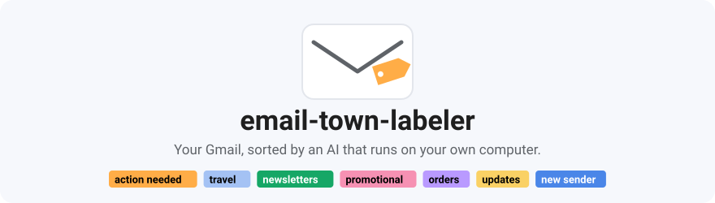
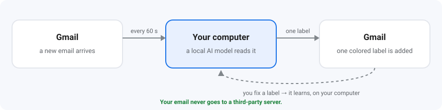
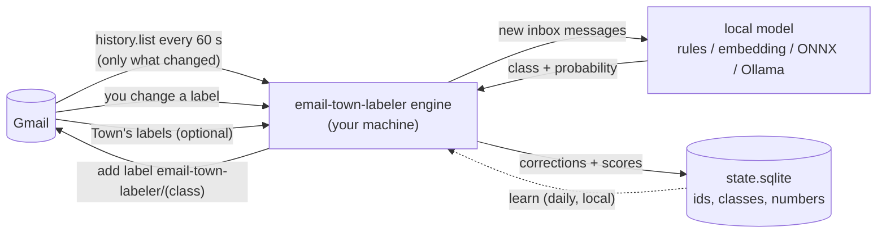

<div align="center">

<picture>
  <source media="(prefers-color-scheme: dark)" srcset="docs/assets/banner-dark.svg">
  
</picture>

**Colored, sorted Gmail — like Town's Auto Inbox — without sending a single email to anyone's servers.**<br>
Free and open source. The AI model runs on your own computer.

[](https://github.com/scamai/email-town-labeler/actions/workflows/ci.yml)
[](LICENSE)


[**Get started**](#get-started-in-5-minutes) · [How it works](#how-it-works) · [Privacy](#what-it-can-see-and-what-it-will-never-do) · [FAQ](#faq) · [Docs](#documentation)

</div>

<br>

<picture>
  <source media="(prefers-color-scheme: dark)" srcset="docs/assets/inbox-dark.svg">
  
</picture>

<p align="center"><sub>Illustration with made-up emails, shown with the label prefix set to <code>e/</code>.</sub></p>

<p align="center">
  <b>87%</b> agreement with Town's labels on held-out mail&nbsp;&nbsp;·&nbsp;&nbsp;<b>~0.25 s</b> per email on a normal CPU&nbsp;&nbsp;·&nbsp;&nbsp;<b>$0</b>, no subscription, no account
</p>

## Why people use it

- 🎨 **A calmer inbox at a glance.** Every new email gets exactly one colored label within a
  minute: what needs you, what's a receipt, what's a sale you can ignore.
- 🔒 **Private by design.** Your mail is read by a model on your machine. There is no
  email-town-labeler server, no account, no telemetry.
- 🙋 **It never hides important mail.** It leans towards flagging *action needed*, and it never
  files mail from people you've written to under *promotional*.
- 📈 **It gets better the more you use it.** Move a label in Gmail and it learns from that, on
  your computer, once a day.
- ↩️ **Nothing to lose.** It only adds labels. One command takes every one of them off again.

## Hosted labelers vs. email-town-labeler

| | Hosted inbox labelers | **email-town-labeler** |
|---|---|---|
| Where your email is read | On the company's servers | **On your own computer** |
| Who holds a token to your mailbox | The company's app | **Only you** (your own Google Cloud app) |
| Learns from your corrections | Their model, their servers | **Locally**, and only if it measurably helps |
| Works if the company shuts down | No | **Yes**, it's yours |
| Can you read the code | No | **Yes**, MIT license |
| Price | Subscription | **Free** |

## What it does to an email

| A new email like… | gets | because |
|---|---|---|
| "Can you sign the lease renewal by Friday?" |  | it asks you to do something |
| "Check-in is open for your flight to Lisbon" |  | flights, hotels, itineraries |
| "Your order #A-1042 has shipped" |  | receipts, invoices, deliveries |
| "Issue #212: small models, big inboxes" |  | something you subscribed to |
| "48 hours only: 30% off everything" |  | marketing, and only when the model is very sure |
| "New sign-in to your account" |  | automated notifications |
| "Hi! We met at the design meetup" |  | a person you've never written to |

Everything else (most personal mail) is left alone. [All labels and how to rename them ↓](#under-the-hood)

## How it works

<picture>
  <source media="(prefers-color-scheme: dark)" srcset="docs/assets/how-it-works-dark.svg">
  
</picture>

1. Every ~60 seconds it asks Gmail what's new (only what changed).
2. A small AI model on your computer reads the sender, subject and the start of the email, in memory.
3. It adds **one** label in Gmail. You use those labels however you like: filters, search, or just a glance.
4. When you move or remove a label, it remembers. Once a day it quietly learns from that.

## What it can see, and what it will never do

**What it can see.** Your Gmail, through Google's `gmail.modify` permission. That's the
narrowest permission that lets an app both read a message and change its labels. Google's
consent screen describes it as "read, compose, and send"; email-town-labeler uses only the
reading and labeling parts ([exactly what it does](docs/privacy.md#what-gmailmodify-allows-and-what-email-town-labeler-does)).

**It will never:**

- ❌ send, delete, archive, move or mark any email as read
- ❌ upload your email anywhere (the only network traffic is the Gmail API, plus a model download you ask for)
- ❌ phone home: no analytics, no crash reports, no update checks
- ❌ store your email: its local database holds message ids, label names and numbers, never subjects, senders or bodies
- ❌ touch any label except its own

**How to take it all back:** `email-town-labeler undo` removes every label it ever added, and
<https://myaccount.google.com/permissions> revokes its access. Full threat model: [docs/privacy.md](docs/privacy.md).

## Get started in 5 minutes

You need Python 3.10+ (macOS, Linux or Windows) and a Gmail or Google Workspace account.

**1. Install**

```bash
pipx install "email-town-labeler[onnx] @ git+https://github.com/scamai/email-town-labeler"
```

**2. Create your own Google sign-in** (one time, about 10 minutes, free). This is what keeps
anyone else from ever holding access to your mailbox. Follow the
[step-by-step guide](docs/google-cloud-setup.md); you end up with a `client_secret_….json` file.

**3. Run the setup wizard**

```bash
email-town-labeler setup
```

It signs you in, downloads the model (about 820 MB, once, checksum-verified) and shows a
**preview on your 5 newest emails** of the labels it would add. Nothing is changed yet.

**4. Turn it on**

```bash
email-town-labeler service install
```

That's it: new mail gets a label within a minute, in the background, after restarts too.
Check on it any time with `email-town-labeler status`.

> [!NOTE]
> **Not on PyPI yet.** The name `email-town-labeler` on PyPI belongs to an unrelated project.
> Install from GitHub as shown; **do not** `pip install email-town-labeler`.

<details>
<summary><b>More install options</b> (pip, uv, gcloud helper, personal-Gmail note)</summary>

- [pipx](https://pipx.pypa.io) keeps it in its own environment. In a virtualenv,
  `pip install "email-town-labeler[onnx] @ git+https://github.com/scamai/email-town-labeler"`
  works too, as does `uv tool install` with the same argument. Without `[onnx]` you get the
  dependency-free `rules` model only.
- Print the gcloud commands for the scriptable part of the Google Cloud setup, plus console links
  for the rest:

  ```bash
  email-town-labeler gcp-setup --print --project my-email-town-labeler
  ```

  From a clone of this repository, `scripts/gcp_setup.sh` (macOS / Linux) or
  `scripts\gcp_setup.ps1` (Windows) runs those commands for you.
- **Personal Gmail:** read [step 4](docs/google-cloud-setup.md#4-audience-testing-vs-production-external-only)
  of the guide. In Google's default "Testing" mode, logins expire every 7 days.
- `service install` uses launchd (macOS), systemd `--user` (Linux) or Task Scheduler (Windows).
- Want your existing inbox labeled too? `email-town-labeler backfill --days 30`.

</details>

<details>
<summary><b>Docker</b> (servers and home labs)</summary>

All state lives in the `/data` volume; the container runs as a non-root user and exposes no ports.

```bash
git clone https://github.com/scamai/email-town-labeler && cd email-town-labeler/docker
docker compose build                                 # includes the onnx extra; EXTRAS=embed,onnx adds torch

# copy your OAuth client JSON into the volume
docker compose run --rm -T --entrypoint sh email-town-labeler \
  -c 'mkdir -p /data/config && cat > /data/config/client_secret.json' < ~/Downloads/client_secret_XXXX.json

# sign in without a browser in the container (open the printed URL anywhere, approve, and
# paste back the http://localhost/... URL you land on), download the default model into the
# volume, and dry-run it on your 5 newest messages
docker compose run --rm email-town-labeler setup --headless --model town-modernbert

docker compose up -d
docker compose logs -f
```

Once releases are published, the image will also be available as `ghcr.io/scamai/email-town-labeler`
(`:latest`, `:X.Y.Z`, and `-embed` variants).

The image's healthcheck runs `email-town-labeler status --json`, which exits non-zero when there is no
token, when no poll has succeeded yet 15 minutes after setup, or when the last successful poll
is older than `max(10 x poll_seconds, 15 min)`. The container reports `unhealthy` until you
have logged in.

</details>

## What works today

| Status | Feature | Where |
|---|---|---|
| ✅ | Automatic labels on new Gmail / Google Workspace mail | |
| ✅ | Town's label colors, or your own | `[label_colors]` |
| ✅ | Learns from your corrections (and from Town's labels, if you still run it) | `learn` |
| ✅ | Background service on macOS, Linux and Windows; Docker | `service install` |
| ✅ | Preview mode, full undo | `--dry-run`, `undo` |
| ✅ | Bring your own model: ONNX, Hugging Face, or a local LLM via Ollama | [Models ↓](#under-the-hood) |
| 🟡 | Personal Gmail in Google's "Testing" mode needs a re-login every 7 days | [why](docs/google-cloud-setup.md#4-audience-testing-vs-production-external-only) |
| 🟡 | Install from PyPI | not yet: install from GitHub |
| 🔴 | Outlook, IMAP, Fastmail | not planned yet |
| 🔴 | Instant push instead of 60-second polling | not built |
| ⛔ | Archiving, deleting, sending or auto-replying | never, by design |

---

## Under the hood

Everything below is the technical detail, folded so the page stays short. Open what you need.

<details>
<summary><b>Commands</b></summary>

| Command | What it does |
|---|---|
| `email-town-labeler setup` | Guided first-time setup: client secret, login, model, dry run, optional service install |
| `email-town-labeler login [--headless]` | (Re)authorize Gmail access. `--headless` for machines without a browser |
| `email-town-labeler run` | Run the labeler in the foreground, polling every `poll_seconds` |
| `email-town-labeler once` | Do a single poll and exit (good for cron or testing) |
| `email-town-labeler backfill [--days N] [--limit N] [--dry-run]` | Classify mail already in your inbox (default: last 7 days) |
| `email-town-labeler status [--json] [--redact]` | Account, model, last poll, counts per class, service state. Exits 1 when unhealthy. `--redact` masks your address and home paths |
| `email-town-labeler undo [--dry-run]` | Remove every `email-town-labeler/...` label from every message. Touches nothing else |
| `email-town-labeler model list` | Published models (installed or not, with sizes), installed packages, and the active one |
| `email-town-labeler model pull <name\|ref> [--use]` | Download and verify a model package (`town-modernbert`, `hf:...`, a URL); `--use` makes it active |
| `email-town-labeler model info [ref]` | Manifest, license and metrics of a model (default: the active one) |
| `email-town-labeler learn [--dry-run] [--reset] [--export FILE]` | Learn from your corrections (and Town's labels) now: personal head + thresholds, locally. The service does this daily. `--reset` goes back to the model as shipped |
| `email-town-labeler personalize [--strength X] [--reset]` | Refit a head-based model's own head on your corrections; for other models (like `town-modernbert`) the same as `learn` |
| `email-town-labeler contacts rebuild \| count [--json]` | Rescan sent mail for the addresses you write to (headers only) / show how many are stored. `contacts list --yes-show-addresses` is the only command that prints them |
| `email-town-labeler service install \| uninstall \| status` | Manage the background service |
| `email-town-labeler doctor [--redact]` | Check config, token, scopes, Gmail access, model, labels |
| `email-town-labeler gcp-setup --print [--project ID]` | Print the gcloud commands that prepare a Google Cloud project (runs nothing) |
| `email-town-labeler --version` | Print the version |

Global options, before or after the command: `--home DIR` (same as `EMAIL_TOWN_LABELER_HOME`), `-v` /
`-vv` for more logging. Exit codes: `0` success, `1` error, `2` usage error. Only one `run`,
`once`, `backfill` or `undo` runs per data directory at a time; a second exits with `1`.

</details>

<details>
<summary><b>Labels</b></summary>

| Label in Gmail | Applied to |
|---|---|
| `email-town-labeler/action needed` | mail that asks you to do something: reply, approve, pay, sign, review, decide |
| `email-town-labeler/newsletters` | newsletters, digests and blog posts you subscribed to |
| `email-town-labeler/promotional` | marketing, sales outreach, promotional offers |
| `email-town-labeler/orders` | receipts, invoices, order confirmations, shipping updates |
| `email-town-labeler/travel` | flights, hotels, rentals, itineraries, check-in notices |
| `email-town-labeler/updates` | automated notifications: account, security, status changes |
| `email-town-labeler/new sender` | Primary-tab mail that fits none of the above, from an address you have never sent mail to (`[policy] new_sender`) |
| `email-town-labeler/unknown` | low-confidence or "none of the above"; only if `unknown_action = "label"` |

At most one email-town-labeler label per message. Which one is decided by a policy you can tune in
`[policy]` (see [configuration.md](docs/configuration.md#policy)): `action needed` as soon as
the model gives it 20 %, `promotional` only above 60 % and never for people you have written
to (built-in defaults; a model can recommend its own, and `town-modernbert` uses 7 % and
80 %). Rename them under `[labels]` in the config, recolor them under `[label_colors]` (by
default they get Town's colors), or shorten the `email-town-labeler` prefix with `label_prefix`
(for example `label_prefix = "e"` gives `e/action needed`).

</details>

<details>
<summary><b>Configuration</b></summary>

`email-town-labeler setup` writes `config.toml`; the defaults are sensible:

```toml
[gmail]
label_prefix = "email-town-labeler"
poll_seconds = 60
skip_label_names = []        # never touch mail with these labels

[model]
ref = "town-modernbert"      # or "rules": no ML dependencies, no download
min_confidence = 0.55        # below this: "unknown"
unknown_action = "skip"      # or "label"
device = "cpu"
keep_loaded_minutes = 10     # free the model's memory after 10 min without mail; -1: keep it loaded

[engine]
dry_run = false              # true: classify and record, never change Gmail

[policy]
# action_threshold = 0.2     # lower: more "action needed" (fewer missed, more false alarms)
# promotional_threshold = 0.6  # higher: less uncertain mail filed under "promotional"
#   left unset, these two come from the model (town-modernbert: 0.07 and 0.8)
protect_known_contacts = true
new_sender = true
```

File locations per OS, every key, and `EMAIL_TOWN_LABELER_HOME`: [docs/configuration.md](docs/configuration.md).

</details>

<details>
<summary><b>Models</b>: the default model, its accuracy, and other backends</summary>

### The default: `town-modernbert`

`email-town-labeler setup` offers it, or get it any time with:

```bash
email-town-labeler model pull town-modernbert --use
```

- **What it is:** ModernBERT-large fine-tuned to pick one of the seven classes, exported to
  ONNX so it runs without PyTorch (needs the `[onnx]` extra). An 824 MB download from the
  [v0.1.0 release](https://github.com/scamai/email-town-labeler/releases/tag/v0.1.0); the
  archive's sha256 is pinned in the code and every file is checked against its manifest.
  `town-modernbert-torch` is the same model as PyTorch weights (635 MB, `[embed]` extra), and
  `town-modernbert-int8` the same model with int8 weights (263 MB, about half the memory, nearly
  the same labels; [model card](docs/model-cards/town-modernbert-int8.md)).
- **What it was trained on:** 4,176 inbound emails from **one person's Gmail inbox** (English,
  July–October 2026), labeled by a hosted auto-labeling tool's six content labels. The mailbox
  owner consented to publishing the weights. Fine-tuned models can memorise fragments of their
  training data (names, senders, subject lines). The labels reflect one person's inbox and one
  tool's taxonomy, so expect it to fit your mail less well than it fits theirs. Read the
  [model card](docs/model-cards/town-modernbert.md) and [privacy.md](docs/privacy.md#the-published-model-and-whose-mail-it-learned-from).
- **Speed:** on a CPU with 6 threads, about 0.2–0.3 s per email.
- **Held-out numbers (from the model card):** a copy trained on half the emails (2,075, split by
  thread) and scored on the other half (2,101): **7-way accuracy 87.3%** (95% CI 85.9–88.8),
  macro-F1 0.807 over the 5 classes with at least 20 test emails. With the recommended policy
  (action needed at ≥0.07, promotional only at ≥0.8), **action-needed recall 0.88** (precision
  0.41), promotional precision 0.82, accuracy 84.3%. The published weights were then retrained
  on all 4,176 emails, so these numbers describe the method, not a held-out test of the exact
  weights, and they measure agreement with one inbox's labels, not with yours.

The model ships recommended thresholds (`action_threshold = 0.07`,
`promotional_threshold = 0.8`); they apply unless you set those keys in `config.toml`.
`email-town-labeler status` shows the values in effect and where they come from.

### Backends

The model is a plug-in: a directory with a `model.json` manifest and its files, run by one of
the built-in backends.

| Backend | Install | Notes |
|---|---|---|
| `rules` | included | Heuristics over Gmail's categories and mail headers. No ML dependencies, no download. The fallback when the `[onnx]` extra is missing. |
| `embedding_probe` | `pipx install --force "email-town-labeler[embed] @ git+https://github.com/scamai/email-town-labeler"` | Sentence-transformers embedder + small linear head. Personalizable. |
| `onnx_classifier` | `pipx install --force "email-town-labeler[onnx] @ git+https://github.com/scamai/email-town-labeler"` | ONNX encoder + linear head, no torch. Personalizable. |
| `hf_sequence_classifier` | `pipx install --force "email-town-labeler[embed] @ git+https://github.com/scamai/email-town-labeler"` | A fine-tuned transformers classifier (BERT, ModernBERT, ...) shipped inside the package (`town-modernbert-torch`). |
| `onnx_sequence_classifier` | `pipx install --force "email-town-labeler[onnx] @ git+https://github.com/scamai/email-town-labeler"` | The same classifier as one ONNX graph, no torch (`town-modernbert`). |
| `ollama_choice` | a running [Ollama](https://ollama.com) | Asks a local LLM. No training needed; slower. |

```bash
email-town-labeler model list                       # published models, installed packages, the active one
email-town-labeler model pull hf:ORG/REPO@REVISION  # or a local directory, or an https .tar.gz
```

Then set `[model] ref` to the package name and restart the service. How models are packaged,
evaluated and accepted: [docs/models.md](docs/models.md).

</details>

<details>
<summary><b>Learning from your corrections</b></summary>

Fix labels in Gmail the way you normally would: remove the email-town-labeler label, or swap it for
the right `email-town-labeler/...` one. email-town-labeler records each correction (ids and class
names only). If you still run Town, the labels Town puts on the same mail are used as ground
truth too (turn that off with `[learn] teacher = "off"`). Reading or archiving mail is never used.

The service learns from these once a day, on your machine, from numbers it stored when it
labeled each message (no mail is re-read):

- a small **personal head** on the model's scores, pulled toward the unchanged model so a few
  corrections only nudge it, and used **only if it beats the model on held-out signals**;
- re-tuned `action_threshold` / `promotional_threshold`: `action needed` recall first, and
  nothing important in `promotional`.

```bash
email-town-labeler status          # signals so far; whether the personal head is active, its held-out score
email-town-labeler learn           # learn now instead of waiting
email-town-labeler learn --reset   # forget it all and use the model as shipped
```

This works with every model, including `town-modernbert`. Details and settings:
[docs/models.md](docs/models.md#improving-from-use-learn). The learned file is derived from your
mail: keep it private.

</details>

<details>
<summary><b>Architecture diagram</b></summary>



New inbox messages are fetched, rendered to a short text (sender, subject, list headers, start
of the body) in memory, and classified by the local model. A labeling policy turns the model's
probabilities into one `email-town-labeler/<class>` label: it leans towards `action needed`,
keeps uncertain mail and people you write to out of `promotional`, and marks Primary mail from
strangers as `new sender`. More: [docs/architecture.md](docs/architecture.md).

</details>

<details>
<summary><b>Uninstall and undo</b></summary>

```bash
email-town-labeler service uninstall   # stop the background labeler
email-town-labeler undo                # remove every email-town-labeler/... label; nothing else is touched
```

Then revoke access at <https://myaccount.google.com/permissions> and delete the config and
data directories (see [docs/configuration.md](docs/configuration.md#files-and-directories)).

</details>

<details>
<summary><b>Limitations</b></summary>

- Gmail and Google Workspace only.
- Polling, not push: labels appear within about `poll_seconds` of arrival. Push via Pub/Sub
  would need a Google Cloud Pub/Sub topic and is not implemented.
- One label per message from a fixed set of seven classes (plus the rule-based `new sender`).
- The default model `town-modernbert` learned from one person's inbox; on yours it will make
  more mistakes than its published numbers suggest. It needs the `[onnx]` extra, about 1.6 GB
  of disk (an 824 MB download) and about 3 GB of memory while it classifies (measured on an
  Apple-silicon Mac; the optional `town-modernbert-int8` peaked at about half); the background service gives that memory back after 10 minutes without
  mail (`[model] keep_loaded_minutes`). `rules` is a heuristic baseline with limited quality.
- Learning only re-weights what the model already sees (its scores plus a few yes/no facts);
  retraining the model itself is an advanced, manual path
  ([docs/models.md](docs/models.md#advanced-full-fine-tuning-not-built-in)).
- Personal Gmail with an app in "Testing" status must log in again every 7 days.
- Refitting a model's own head (`personalize`) needs an `embedding_probe` or `onnx_classifier` model.
- Only new inbox mail is labeled automatically; archived mail and other folders are ignored.

</details>

## FAQ

<details>
<summary><b>Does it send my email anywhere?</b></summary>

No. It reads mail from the Gmail API and classifies it in-process. The only other network
traffic is a model download you ask for. The `ollama_choice` backend sends text to an Ollama
server, and only on this machine (`localhost`) unless you opt in with
`[model] allow_remote_endpoint = true`; a model package cannot change that
([details](docs/privacy.md#model-endpoints)).

</details>

<details>
<summary><b>Why do I need my own Google Cloud project?</b></summary>

So that nobody else's app holds a token to your mailbox. It also means email-town-labeler has no
server-side component that could leak or be shut down.

</details>

<details>
<summary><b>Why does Google say the app is unverified, or "unsafe"?</b></summary>

Because it is your own app and Google hasn't reviewed it. Verification is meant for apps
distributed to the public. You are the developer here.
[Details](docs/google-cloud-setup.md#4-audience-testing-vs-production-external-only).

</details>

<details>
<summary><b>Why does the consent screen say it can read, send and compose mail?</b></summary>

That is Google's description of the `gmail.modify` scope, the narrowest scope that allows
both reading a message and changing its labels. email-town-labeler only adds and removes its own
labels; [here is exactly what it does](docs/privacy.md#what-gmailmodify-allows-and-what-email-town-labeler-does).

</details>

<details>
<summary><b>What happens if my laptop sleeps or is off?</b></summary>

On the next poll email-town-labeler picks up everything that changed while it was away. If it was away
so long that Gmail no longer has that history, it scans inbox mail received since its last
successful poll instead (at most 30 days back, configurable, and never mail from before you
set it up).

</details>

<details>
<summary><b>Does it label mail that was already there?</b></summary>

Only if you run `email-town-labeler backfill`. A backfill is limited by Gmail's API quota to roughly
5,000 messages an hour.

</details>

<details>
<summary><b>Can I use it with several accounts?</b></summary>

Yes: one instance per account, each with its own `EMAIL_TOWN_LABELER_HOME` (or its own Docker volume).

</details>

<details>
<summary><b>Does it work with Outlook, IMAP or Fastmail?</b></summary>

No. Gmail and Google Workspace only, through the Gmail API.

</details>

<details>
<summary><b>Does it need a GPU?</b></summary>

No. Everything targets CPU. `device = "cuda"` is available for the embedding and ONNX
backends.

</details>

<details>
<summary><b>What does it cost?</b></summary>

Nothing. The Gmail API is free at this usage level, and one mailbox stays far below Google's
per-project limits ([numbers](docs/google-cloud-setup.md#quota)).

</details>

## Documentation

| I want to… | Read |
|---|---|
| set up the Google sign-in step by step | [Google Cloud setup](docs/google-cloud-setup.md) |
| know exactly what it can access and store | [Privacy and threat model](docs/privacy.md) |
| change labels, colors, thresholds | [Configuration](docs/configuration.md) |
| use or build a different model | [Models](docs/models.md) · [model card](docs/model-cards/town-modernbert.md) |
| fix something that isn't working | [Troubleshooting](docs/troubleshooting.md) |
| understand or contribute to the code | [Architecture](docs/architecture.md) · [Design spec](docs/design-spec.md) |

## Contributing

Bug reports, docs fixes, backends and models are welcome. Read
[CONTRIBUTING.md](CONTRIBUTING.md) first, especially the privacy rule: **no real email, in
any form, in code, tests, fixtures, issues or logs.** Security or privacy problems go to
security@scam.ai, not to public issues ([SECURITY.md](SECURITY.md)).

If it makes your inbox calmer, a ⭐ helps other people find it.

## License

[MIT](LICENSE). Copyright (c) 2026 Reality Inc. (Scam.ai). Not affiliated with Town.
