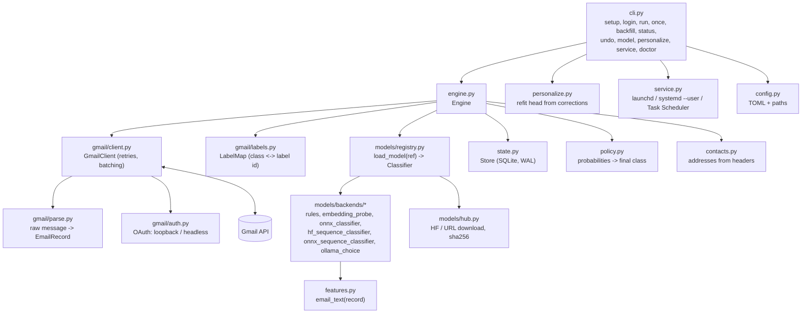
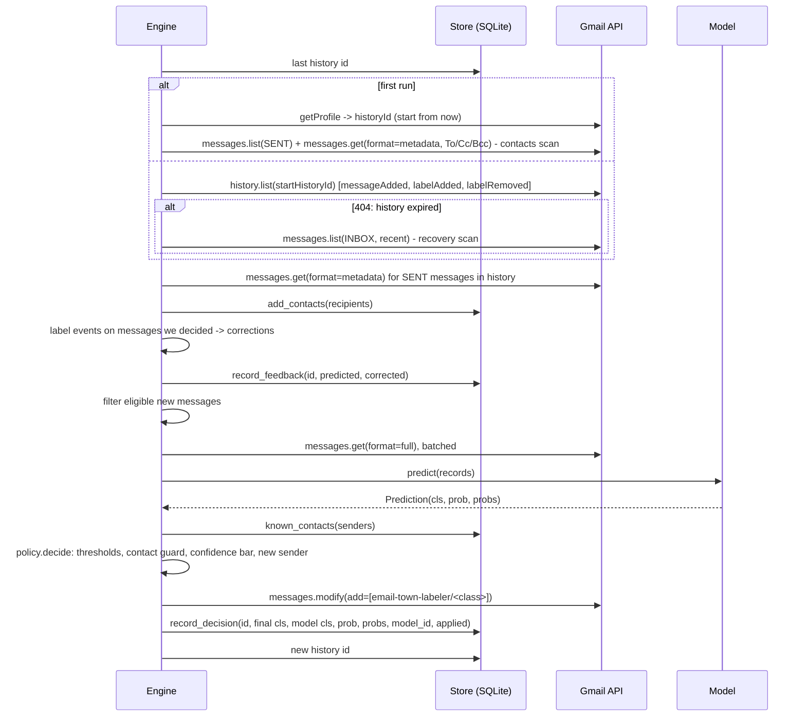

# Architecture

A short tour for contributors. The contracts between modules are specified in
[design-spec.md](design-spec.md); this page explains how the pieces fit.

## Overview

## The sync loop

`Engine.sync_once()` is one poll. `run` calls it every `poll_seconds`.

Properties that matter:

- **Incremental.** Gmail's history API returns only what changed since the last stored
  history id, so an idle poll is one cheap call.
- **Restartable.** The history id is saved after each successful poll. Crashing mid-poll
  repeats at most that poll; already-decided messages are skipped.
- **Self-healing.** If the history id is too old, Gmail returns 404; the engine scans recent
  inbox mail instead and resumes from a fresh history id.
- **Backs off.** Transient errors (429, 5xx, rate-limit 403s) are retried with exponential
  backoff and jitter in `GmailClient`; repeated poll failures back off in the loop, capped.
- **Never destructive.** The only label changes are adds/removes of labels under the
  configured prefix (see [privacy.md](privacy.md#what-gmailmodify-allows-and-what-email-town-labeler-does)).

## Feedback capture

The same history call that delivers new mail also reports label changes. When a label under
our prefix is removed from, or added to, a message email-town-labeler decided on, the engine records
`(message id, predicted class, corrected class or none)`. No content is stored, only ids and
class names. `personalize` later re-fetches those messages from Gmail to train on them.

## Models

A model is a package (`model.json` + files) resolved by `registry.load_model(ref)` and run by
a backend. The engine only sees the `Classifier` protocol from `models/base.py`. Details:
[models.md](models.md).

## State

`state.sqlite` (WAL mode, versioned schema) has key/value settings (history id, bootstrap
info), decisions (id, class, probability, probabilities, model id, applied flag, time), and
feedback (id, predicted, corrected, time). Nothing in it is mail content.

## Background service

`service.py` installs `email-town-labeler run` to start at login:

| OS | Mechanism | File |
|---|---|---|
| macOS | launchd user agent | `~/Library/LaunchAgents/...plist` |
| Linux | systemd user unit | `~/.config/systemd/user/...service` (use `loginctl enable-linger` to run while logged out) |
| Windows | Task Scheduler, on logon | task `email-town-labeler` |

On servers, prefer Docker (`restart: unless-stopped`) or your own process manager running
`email-town-labeler run`.

## Testing without Google

`tests/fakes/fake_service.py` is an in-memory, `googleapiclient`-shaped Gmail with history
semantics, so the real `GmailClient` and `Engine` run end to end against it with the `rules`
model: no network, no weights, no real mail. See
[CONTRIBUTING.md](../CONTRIBUTING.md#running-tests).

## Cross-platform rules

`pathlib` everywhere; paths from `platformdirs`; no shell-isms; OS-specific code only in
`service.py`. CI runs on Linux, macOS and Windows with Python 3.10, 3.12 and 3.13.
