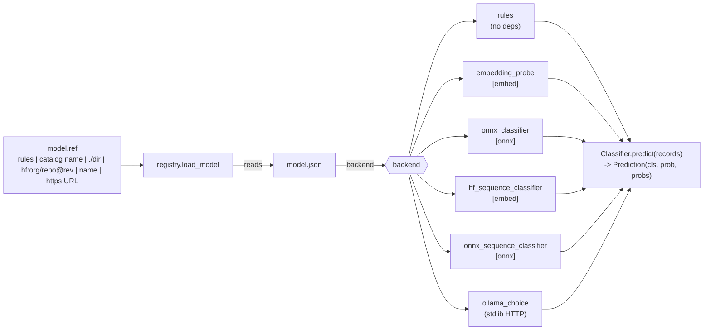

# Models

email-town-labeler is model-agnostic. The labeling loop, Gmail integration and state handling are the
same no matter which model decides the label. A model is a **package** (a directory with a
`model.json` manifest plus its files) that names a **backend** (code shipped with email-town-labeler
that knows how to run that kind of package).

The design is inspired by hosted inbox-labeling tools, with one difference that drives
everything here: the model runs on your machine and nothing about your mail leaves it.

> **Default model: [`town-modernbert`](#published-models-the-catalog).** ModernBERT-large
> fine-tuned on one person's consenting inbox, run with ONNX. `setup` downloads it when the
> `[onnx]` extra is installed; otherwise the default is the built-in `rules` model, which needs
> no ML dependencies and no download.

## Published models: the catalog

email-town-labeler knows a short list of published packages by name. Each entry pins the
release URL, the archive's sha256 and its size, so `model pull <name>` (or `[model] ref =
"<name>"`, downloaded on first use) verifies the archive **before** extracting it and refuses a
mismatch, and then checks every file against the package's `model.json` as usual.

| Name | Package | Backend | Extra | Download | Notes |
|---|---|---|---|---|---|
| `town-modernbert` (default) | `town-labels-modernbert-large-onnx@1` | `onnx_sequence_classifier` | `[onnx]` | 824 MB (1.6 GB on disk) | no PyTorch needed; slightly faster |
| `town-modernbert-torch` | `town-labels-modernbert-large@1` | `hf_sequence_classifier` | `[embed]` | 635 MB (0.8 GB on disk) | the same model as PyTorch bf16 weights, run in float32 on CPU |

Both download from `https://github.com/scamai/email-town-labeler/releases/download/v0.1.0/`.

```bash
email-town-labeler model list                        # catalog: installed / not installed, sizes, extras
email-town-labeler model pull town-modernbert --use  # download, verify, install, make it model.ref
email-town-labeler model info                        # manifest, metrics, policy in effect
```

Downloads show progress (bytes and %) on stderr. `model pull` of an installed catalog model
does nothing unless you pass `--force`. If the extra is missing, loading the model fails before
anything is downloaded, with the `pip` / `pipx` command that adds it.

### `town-modernbert`

The [model card](model-cards/town-modernbert.md) (also `README.md` inside both packages) is
the reference; in short:

- **Training data:** 4,176 inbound emails from one person's Gmail inbox (English,
  July–October 2026), labeled by a hosted auto-labeling tool's six content labels; mail it left
  unlabeled is `unknown`. The mailbox owner consented to publishing these weights. Fine-tuned
  models can memorise fragments of their training data (names, senders, subject lines); see
  [privacy.md](privacy.md#the-published-model-and-whose-mail-it-learned-from).
- **Input:** `features.email_text` (sender, subject, mailing-list and calendar flags, the first
  2,000 body characters), at most 512 tokens.
- **Evaluation:** a copy trained on half the emails (2,075, split by thread) was scored on the
  other half (2,101): 7-way accuracy 87.3% (95% CI 85.9–88.8), macro-F1 0.807 over the 5
  classes with ≥20 test emails (always-"updates" baseline 40.5%, Gmail-category rules 60.8%).
  With the recommended policy below, action_needed recall 0.88 (precision 0.41), promotional
  precision 0.82, accuracy 84.3%. The published weights were then retrained on all 4,176
  emails, so these numbers describe the method, not a held-out test of the exact weights.
- **Recommended policy:** `config.recommended_policy` = `action_threshold 0.07`,
  `promotional_threshold 0.8` (chosen on the training half). It applies unless you set those
  keys in `config.toml` ([configuration.md](configuration.md#policy)).
- **Speed:** CPU, 6 threads: about 0.2–0.3 s per email.
- **License:** Apache-2.0, like the base model (answerdotai/ModernBERT-large).
- Not personalizable (`personalize` needs a head-based backend).

### Mirrors and offline installs

`EMAIL_TOWN_LABELER_CATALOG_BASE_URL` replaces the release URL prefix for every catalog entry,
for example `file:///srv/models/` or an internal https mirror. The sha256 pins still apply, so
a mirror cannot substitute a different archive. It is meant for tests, CI and air-gapped
machines; it is an environment variable, not a config key.

## Recommended thresholds: `config.recommended_policy`

A package can recommend `[policy]` thresholds tuned to its own probabilities:

```json
"config": { "recommended_policy": { "action_threshold": 0.07, "promotional_threshold": 0.8 } }
```

Each recommended key is used unless the user set that key in `config.toml`; invalid values
(out of range, not a number) are ignored with a warning. Only these two keys can be
recommended. `status`, `doctor` and `model info` show the effective values and their source
(`model`, `config` or `default`).

## The label set

Every model predicts a probability for each of seven classes (from
`src/email_town_labeler/taxonomy.py`):

| Class | Gmail label (default) | Meaning |
|---|---|---|
| `action_needed` | `email-town-labeler/action needed` | asks you to do something: reply, approve, pay, sign, review or decide |
| `newsletters` | `email-town-labeler/newsletters` | a newsletter, digest or blog post you subscribed to |
| `promotional` | `email-town-labeler/promotional` | unsolicited marketing, sales outreach or a promotional offer |
| `orders` | `email-town-labeler/orders` | a receipt, invoice, order confirmation or shipping update |
| `travel` | `email-town-labeler/travel` | flights, hotels, rentals, itineraries or check-in notices |
| `updates` | `email-town-labeler/updates` | an automated notification from an app or service: account, security, status |
| `unknown` | `email-town-labeler/unknown` | none of these: personal or work mail that needs no category |

Models predict these seven classes and nothing else. The engine then applies the labeling
policy (`[policy]`): `action_needed` once its probability reaches `action_threshold`, otherwise
the top class, with `promotional` held to `promotional_threshold` and never used for a known
contact. If the chosen class's probability is below `model.min_confidence` (default 0.55;
`action_needed` uses `action_threshold` instead), the message is treated as `unknown`; an
`unknown` Primary-tab message from someone you have never written to becomes `new_sender`
(label `email-town-labeler/new sender`), a rule after the model, not a model class. Finally
`model.unknown_action` decides whether `unknown` gets a label (`"label"`) or is only recorded
(`"skip"`, the default). The full order is in
[configuration.md](configuration.md#how-a-message-gets-its-label). The state database keeps
both the model's class and the final class, so an evaluation can tell them apart.

## Architecture



Every model sees the same input: `features.email_text(record)`, a short rendering of the
sender, subject, whether it came from a mailing list, whether it carries a calendar invite,
and the first 2,000 characters of the body text. Changing that function changes model inputs,
so it requires a model version bump.

### Backends

| Backend | Extra | What it is | Typical use |
|---|---|---|---|
| `rules` | none | Heuristics over Gmail's own category labels and headers (`List-Unsubscribe`, `List-Id`, calendar parts, ...). Built in, no files. | Default. Works out of the box; also what CI uses. |
| `embedding_probe` | `[embed]` (sentence-transformers, torch) | A sentence-transformers embedder from Hugging Face (pinned revision) plus a linear softmax head stored as two `.npy` files. | The main path for pretrained models. Cheap to personalize. |
| `onnx_classifier` | `[onnx]` (onnxruntime, tokenizers) | Same shape as `embedding_probe`, but the encoder is an `.onnx` file and the tokenizer a `tokenizer.json`; no torch. | Smaller installs, Docker, low-RAM machines. Also personalizable. |
| `hf_sequence_classifier` | `[embed]` (transformers comes with sentence-transformers; torch) | A fine-tuned transformers `AutoModelForSequenceClassification` (BERT, ModernBERT, ...) whose checkpoint and tokenizer live inside the package. The model's softmax is the prediction. | Fine-tuned encoders, usually more accurate than a linear probe. Not personalizable (no separate head). |
| `onnx_sequence_classifier` | `[onnx]` (onnxruntime, tokenizers) | The same classifier exported to one `.onnx` graph (`input_ids`, `attention_mask` -> `logits`); no torch. | Fine-tuned encoders without torch at runtime. |
| `ollama_choice` | none (talks to a local [Ollama](https://ollama.com)) | Asks a local LLM a lettered 7-way multiple-choice question; probabilities from the answer token's logprobs when available. | Experiments with no training data. Slower; quality depends on the LLM. |

A missing extra produces a clear error that names it, for example
`pip install "email-town-labeler[embed] @ git+https://github.com/scamai/email-town-labeler"` (email-town-labeler is not
on PyPI yet).

Third-party backends can register through the `email_town_labeler.backends` entry-point group
(`name = "package.module:load"`, where `load(manifest, *, device, **kw)` returns a
`Classifier`).

### Getting a model: `model.ref` forms

| `model.ref` | Meaning |
|---|---|
| `rules` | the built-in rules model |
| `town-modernbert`, `town-modernbert-torch` | a [catalog](#published-models-the-catalog) model: installed copy, else a pinned download |
| `./path/to/dir` | a local directory containing `model.json` |
| `hf:<org>/<repo>[@<revision>]` | a Hugging Face Hub repo; pin a revision (commit hash or tag) for reproducibility |
| `https://.../package.tar.gz` (or `.zip`) | an archive containing `model.json` at its root |
| `<name>` | a package already installed under `<data dir>/models/<name>/` |

```bash
email-town-labeler model list                       # catalog + installed packages + the active one
email-town-labeler model pull hf:ORG/REPO@REVISION  # download, sha256-check, install
email-town-labeler model info                       # manifest, license, metrics of the active model
```

Then set `[model] ref = "<name>"` in `config.toml` (or pass `--use` to `model pull`, or pick
it in `email-town-labeler setup`) and restart the service. Downloads only happen when you run `model pull`, or when the configured
model is not installed yet. Every file listed in the manifest's `files` map is checked against
its sha256 before the package is installed. Archives with absolute paths, `..`, links or
device entries are refused.

For `embedding_probe`, the embedder weights themselves come from the Hugging Face repo named
in the manifest, at the pinned revision, and are cached in the Hugging Face cache
(`HF_HOME`; `/data/hf-cache` in Docker). `hf_sequence_classifier` and
`onnx_sequence_classifier` packages are self-contained: the weights are package files, so
nothing else is downloaded.

## The manifest: `model.json`

| Field | Type | Required | Meaning |
|---|---|---|---|
| `name` | string | yes | package name; also the install directory name (`[A-Za-z0-9._-]`) |
| `version` | string | yes | package version; `name@version` is the model id recorded with every decision |
| `backend` | string | yes | `rules`, `embedding_probe`, `onnx_classifier`, `hf_sequence_classifier`, `onnx_sequence_classifier`, `ollama_choice`, or a registered plug-in |
| `classes` | list of strings | no | class order of the head's rows; defaults to all seven classes; must be a subset of them |
| `description` | string | no | one or two sentences |
| `license` | string | yes for shipped models | SPDX id of the package (weights + head), for example `Apache-2.0` |
| `files` | object | yes if the package has files | relative path to sha256 hex digest, for every file in the package |
| `metrics` | object | yes for shipped models | held-out evaluation and a data-card summary (see below) |
| `config` | object | backend-specific | settings for the backend |

### Example: `embedding_probe`

```json
{
  "name": "example-probe",
  "version": "0.1.0",
  "backend": "embedding_probe",
  "classes": ["action_needed", "newsletters", "promotional", "orders", "travel", "updates", "unknown"],
  "description": "Linear probe over a small sentence embedder. Example only, not a real model.",
  "license": "Apache-2.0",
  "files": {
    "coef.npy": "9f2c0e...<64 hex chars>",
    "intercept.npy": "41b7aa...<64 hex chars>",
    "MODEL_CARD.md": "c03d18...<64 hex chars>"
  },
  "metrics": {
    "eval_set": "TBD",
    "n_eval": "TBD",
    "accuracy_7way": "TBD",
    "macro_f1": "TBD",
    "per_class_f1": {},
    "confusion_matrix": [],
    "training_data": "TBD: source, license, and consent"
  },
  "config": {
    "embedder": {
      "repo": "ORG/EMBEDDER-REPO",
      "revision": "0123456789abcdef0123456789abcdef01234567"
    },
    "prompt": "Classify this email: ",
    "max_seq_length": 512,
    "normalize": true,
    "batch_size": 8,
    "dim": 768,
    "max_body_chars": 2000,
    "head": { "coef": "coef.npy", "intercept": "intercept.npy" }
  }
}
```

The head computes `softmax(X @ coef.T + intercept)`:

- `coef.npy` is float, shape `(len(classes), dim)`, with rows in `classes` order;
- `intercept.npy` has shape `(len(classes),)`;
- `X` is the (by default L2-normalized) embedding of `email_text(record)`, with `prompt`
  prepended by sentence-transformers.

Both arrays are loaded with `allow_pickle=False`.

`embedder.st_kwargs` (optional) is passed to `SentenceTransformer`, but only through an
allowlist, because it comes from the package: `config_kwargs`, `tokenizer_kwargs`, and
`model_kwargs` limited to `torch_dtype` / `dtype` (`"auto"`, `"float32"`, `"float16"`,
`"bfloat16"`). Anything else (for example `trust_remote_code`, `modules`, `cache_folder`,
or a `revision` / `token` inside the nested objects) makes the package fail to load.
`trust_remote_code` is always `False`: a model package never runs code.

Every path a manifest names (head files, `onnx`, `tokenizer`, `model_dir`) must be relative and stay
inside the package directory: no absolute paths, no `..`, no drive letters, and no symlink
that resolves outside it. Archives (`.tar.gz` / `.zip`) are extracted with a size cap: 2 GB
per file and 4 GB in total by default.

### `onnx_classifier` config

```json
"config": {
  "onnx": "encoder.onnx",
  "tokenizer": "tokenizer.json",
  "output": 0,
  "pooling": "mean",
  "normalize": true,
  "prompt": "",
  "max_seq_length": 512,
  "batch_size": 8,
  "threads": 0,
  "head": { "coef": "coef.npy", "intercept": "intercept.npy" }
}
```

`pooling` is `mean`, `cls`, or `none` (the output is already `(batch, dim)`). `output` is a
graph output index or name. All of `encoder.onnx`, `tokenizer.json` and the head files belong
in `files` with their hashes.

### Example: `hf_sequence_classifier`

```json
{
  "name": "example-bert",
  "version": "1",
  "backend": "hf_sequence_classifier",
  "classes": ["action_needed", "newsletters", "promotional", "orders", "travel", "updates", "unknown"],
  "description": "Fine-tuned encoder, 7-way sequence classification. Example only, not a real model.",
  "license": "Apache-2.0",
  "files": {
    "hf/config.json": "5d1e...<64 hex chars>",
    "hf/model.safetensors": "a93c...<64 hex chars>",
    "hf/tokenizer.json": "77f0...<64 hex chars>",
    "hf/tokenizer_config.json": "0b4e...<64 hex chars>",
    "MODEL_CARD.md": "c03d18...<64 hex chars>"
  },
  "metrics": { "eval_set": "TBD", "macro_f1": "TBD", "training_data": "TBD: source, license, and consent" },
  "config": {
    "model_dir": "hf",
    "labels": ["action_needed", "newsletters", "promotional", "orders", "travel", "updates", "unknown"],
    "max_length": 512,
    "batch_size": 8,
    "threads": 0,
    "stored_dtype": "bfloat16"
  }
}
```

| `config` key | Default | Meaning |
|---|---|---|
| `model_dir` | `"hf"` | directory in the package holding a `save_pretrained` checkpoint: `config.json`, `model.safetensors` (or a sharded safetensors index) and the tokenizer files |
| `labels` | `classes` | head index -> class, as a list or `{"0": "action_needed", ...}`; must name each of the seven classes exactly once and match the model's number of outputs (and its `id2label`, when that names the same classes) |
| `max_length` | `512` | tokens; longer input is truncated |
| `dtype` | float32 on CPU, bfloat16 on CUDA when supported | compute dtype: `float32`, `bfloat16` or `float16` |
| `threads` | `0` | torch intra-op threads (0 = torch's default). Process-wide |
| `batch_size` | `8` | messages per forward pass (batched by similar length) |
| `prompt`, `max_body_chars` | `""`, `2000` | text prepended to `email_text(record)`, and its body cap |

`stored_dtype` is informational: it records how `package_model.py` stored the weights. bf16
weights are upcast to the compute dtype on load, so a bf16 package is half the size on disk
and runs in float32 on CPU.

Safety: the checkpoint is loaded with `local_files_only=True`, `trust_remote_code=False` and
`use_safetensors=True`, so a package never runs code or unpickles anything. `model_dir` goes
through the same path checks as every other manifest path, every file in it must resolve inside
the package (no symlinks out), and a `config.json` that sets `auto_map` is refused.

### `onnx_sequence_classifier` config

```json
"config": {
  "onnx": "model.onnx",
  "tokenizer": "tokenizer.json",
  "output": "logits",
  "labels": ["action_needed", "newsletters", "promotional", "orders", "travel", "updates", "unknown"],
  "max_length": 512,
  "batch_size": 8,
  "threads": 0,
  "pad_id": 50283
}
```

The graph takes `input_ids` and `attention_mask` (plus `token_type_ids` if it declares it),
int64 `(batch, seq)`, and returns logits `(batch, len(labels))`. `output` is an output name or
index; `pad_id` defaults to the tokenizer's padding id. `labels`, `max_length`, `batch_size`,
`prompt` and `max_body_chars` mean the same as for `hf_sequence_classifier`; `threads` sets
onnxruntime's intra-op threads.

Make one from an `hf_sequence_classifier` package with
`scripts/export_onnx.py --seq-classifier --model ./my_bert --out ./my_bert-onnx`. The graph is
float32 (even if the source stores bf16 weights), so it is about twice the size of a bf16 torch
package. The export runs a parity check through the registry on 50 made-up messages (argmax
agreement must be 100% and the largest probability difference at most 1e-3) and records it in
`metrics.parity.onnx_vs_torch`. Exporting a large encoder needs several GB of RAM: about 7 GB
for a ModernBERT-large-sized model.

### `ollama_choice` config

```json
"config": {
  "url": "http://localhost:11434/api/generate",
  "model": "MODEL-TAG",
  "timeout": 120,
  "max_body_chars": 2000,
  "fixed_confidence": 0.6,
  "options": { "temperature": 0 }
}
```

This backend sends the rendered message text to `url`. Because `url` comes from the model
package, email-town-labeler refuses any host that is not loopback (`localhost`, `127.0.0.0/8`, `::1`):
a package cannot make it send your mail elsewhere. If you run Ollama on another machine you
control, opt in yourself with `[model] allow_remote_endpoint = true` in `config.toml` or
`EMAIL_TOWN_LABELER_ALLOW_REMOTE_ENDPOINT=1` (see [privacy.md](privacy.md#model-endpoints)). A
package cannot set this.

## Learning from your corrections: `personalize`

Every time you change a label email-town-labeler applied, it records the correction (message id,
predicted class, corrected class) in `state.sqlite`:

- remove `email-town-labeler/promotional` and add `email-town-labeler/newsletters`: recorded as
  `promotional -> newsletters`;
- only remove the email-town-labeler label: recorded as `promotional -> (none)`, which is used as a
  signal that the prediction was wrong but is not a training label.

`email-town-labeler personalize` turns those corrections into a private model:

1. It re-fetches the corrected messages from Gmail (their content was never stored), renders
   them with `email_text`, and embeds them with the active model's embedder.
2. It refits the softmax head with L2 regularization **anchored to the shipped head**: a
   handful of corrections moves the decision boundary near those emails instead of overwriting
   what the model already knew. The original head is kept as `base_coef.npy` /
   `base_intercept.npy`, so re-running `personalize` re-anchors to it and uses all
   corrections collected so far.
3. It writes a new package `<name>-personal` (version bumped) under `<data dir>/models/`,
   with its `metrics.personalized` block recording only counts and training accuracy before
   and after (no content), and switches `model.ref` to it.

Requirements and limits:

- Works for head-based backends (`embedding_probe`, `onnx_classifier`). `rules`,
  `ollama_choice` and the sequence classifiers (`hf_sequence_classifier`,
  `onnx_sequence_classifier`) have no separate trainable head.
- It needs at least 5 corrections to a specific class (`--min-examples`, default 5); removals
  without a replacement label are not used for training. The fit converges for any number of
  examples, but expect noticeable changes only after a few corrections per class.
- `--strength` (default 1.0) controls how far corrections may move the model away from the
  shipped head.
- Restart the service afterwards so it loads the new package.
- **The personalized package is derived from your mail. Keep it private.** Do not upload or
  share it. See [privacy.md](privacy.md#models-trained-on-your-mail-stay-private).

To go back, set `model.ref` to the original name, or delete the `-personal` directory.

## Training your own model from your labels

If you already sort mail into your own Gmail labels, you can train a head on them locally. The
outline:

1. Map each of your labels to one of the seven classes.
2. Export, on your machine, `email_text(record)` and the mapped class for a sample of
   messages using the same Gmail parsing code (`email_town_labeler.gmail.parse`), so the input
   matches what the model sees in production.
3. Embed the texts with the embedder you will ship in the manifest (same repo, same revision,
   same `prompt`, same `normalize`).
4. Fit a multinomial logistic regression (for example
   `sklearn.linear_model.LogisticRegression(C=..., max_iter=2000)`) and save
   `coef_` and `intercept_` as `coef.npy` / `intercept.npy`, rows in your `classes` order.
5. Package it: `scripts/package_model.py` writes `model.json` with the sha256 of every file
   and validates the package by loading it through the registry:

   ```bash
   python scripts/package_model.py --coef coef.npy --intercept intercept.npy \
       --name my_probe --version 1 --embedder-repo ORG/EMBEDDER --revision COMMIT \
       --prompt "..." --dim 768 --out ./my_probe
   ```

   Optionally convert it to an `onnx_classifier` package (no torch at runtime) with
   `scripts/export_onnx.py --model ./my_probe --out ./my_probe-onnx`, which also checks parity
   between the two.
6. Evaluate on a held-out split (next section), then point `model.ref` at the directory.

If you fine-tuned a whole encoder instead (a transformers `save_pretrained` directory whose
`id2label` names the seven classes), package it as an `hf_sequence_classifier`:

```bash
python scripts/package_model.py --backend hf_sequence_classifier --hf-dir ./checkpoint \
    --name my_bert --version 1 --weights-dtype auto --out ./my_bert
python scripts/export_onnx.py --seq-classifier --model ./my_bert --out ./my_bert-onnx   # optional
```

The checkpoint must render its training text with `features.email_text` and the same
`--max-length` (default 512). `--weights-dtype auto` (the default) stores bf16 weights only if,
on 50 made-up messages, the bf16 package's top class agrees with the float32 checkpoint 100% of
the time, and keeps float32 otherwise; `bfloat16` / `float32` force one. The parity numbers
(argmax agreement, largest and mean probability difference) are recorded in
`metrics.parity.bf16_vs_fp32`. Validation then loads the package through the registry.

The result is trained on your private mail: keep it for your own use. Publishing it would
publish a trace of your mail and your correspondents' words (see
[privacy.md](privacy.md#the-published-model-and-whose-mail-it-learned-from)).

## Evaluation methodology

Numbers reported for any model, in its manifest `metrics`, its model card, or a pull request,
follow this protocol:

- **Held-out data only.** The evaluation set is disjoint from training data, split by sender
  domain (or thread) so near-duplicate mail from one sender cannot land on both sides.
- **7-way accuracy**: fraction of messages whose top class (before the `min_confidence`
  threshold) equals the reference class, `unknown` included.
- **Macro-F1** over the seven classes: the unweighted mean of per-class F1, so rare classes
  such as `travel` count as much as frequent ones. This is the headline number.
- **Per-class precision, recall and F1**, and the **7x7 confusion matrix** (rows = reference,
  columns = predicted, in `CLASSES` order).
- **Coverage at the default threshold**: fraction of messages with top probability at least
  0.55, and accuracy on that covered subset. This is what users experience with the defaults.
- Report the evaluation set's name, size, per-class counts, and how reference labels were
  produced (human annotation, and agreement if multiple annotators).
- Latency on CPU (messages per second, batch size, hardware) is useful but optional.

The numbers published for `town-modernbert` ([its card](model-cards/town-modernbert.md)) follow
this protocol on a thread-split half of its one training inbox, not on a public evaluation set;
no public evaluation set exists yet. Comparisons against other tools are not published unless
they are run on the same evaluation set under this protocol.

## Requirements for a shipped model

A model can become a default, a documented download, or a model in this repository's docs
only if it meets all of these:

1. **Data with consent for this use.** Public corpora with licenses permitting it, synthetic
   data, or mail whose owner gave explicit, informed consent to publishing weights trained on it
   (as for `town-modernbert`). In the last case the model card must say so plainly, including
   that the other people in that mail were not individually asked and that the model may
   memorise fragments of it. Never a mailbox used without its owner's consent.
2. **A model card** following [MODEL_CARD_TEMPLATE.md](../MODEL_CARD_TEMPLATE.md), included in
   the package and listed in `files`.
3. **A license** for the package (`license` in the manifest), compatible with the licenses of
   the embedder and the training data.
4. **Held-out metrics** computed with the protocol above and recorded in `metrics`.
5. **Pinned and hashed.** The embedder revision is a commit hash or immutable tag; every
   package file has a sha256 in `files`.
6. **Same input contract.** Uses `features.email_text` unchanged (or documents the
   `max_body_chars` it sets).
7. **CPU-viable.** Runs on a laptop CPU at a rate that keeps up with normal mail volume; state
   the RAM footprint in the model card.

Proposals go through a GitHub issue first; see
[CONTRIBUTING.md](../CONTRIBUTING.md#proposing-a-model).
