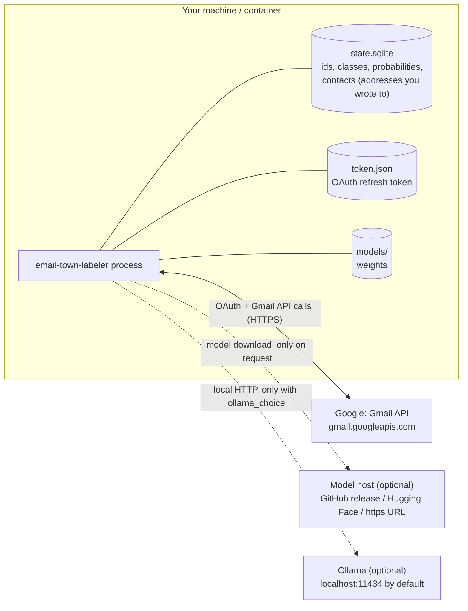

# Privacy and threat model

email-town-labeler exists so that you can have your mail auto-labeled without handing it to a third
party. This page states exactly what goes where, what the tool can and cannot do, and what is
stored on disk. If the code ever disagrees with this page, that is a bug: please report it
(see [SECURITY.md](../SECURITY.md)).

## What goes where

| Data flow | When | Contains mail content? |
|---|---|---|
| email-town-labeler to Google (Gmail API, OAuth endpoints) | always | Google already has your mail; email-town-labeler reads it from Google and sends back label changes. |
| email-town-labeler to GitHub releases, Hugging Face or a model URL | only when you run `model pull` or `setup` downloads a model, or the configured model is not on disk yet | No. A plain download of a model package, verified against sha256 hashes (for published models, the archive's hash is pinned in the code too). |
| email-town-labeler to Ollama | only if you choose the `ollama_choice` backend | Yes: the rendered message text is sent to the Ollama URL in the model package. Only loopback hosts are allowed unless you opt in (see [Model endpoints](#model-endpoints)). |
| email-town-labeler to anyone else | never | There is no telemetry, analytics, crash reporting, update check or "phone home". |

### Model endpoints

A model package is data written by someone else, so nothing in it may decide where your mail
goes or what code runs:

- **`ollama_choice` only talks to this machine by default.** Its `url` comes from the
  package's `model.json`, so email-town-labeler refuses any host other than `localhost`,
  `127.0.0.0/8` or `::1` and fails with an error naming the host. To use Ollama on another
  machine you control, opt in yourself: `[model] allow_remote_endpoint = true` in
  `config.toml` ([configuration.md](configuration.md#model)), or the environment variable
  `EMAIL_TOWN_LABELER_ALLOW_REMOTE_ENDPOINT=1`. A package cannot set either. Once you opt in, the
  message text goes to that host: it is then as private as that host and the network path to
  it (use `https://` off your LAN).
- **Packages never run code.** `embedding_probe` passes only an allowlist of
  sentence-transformers options from the package and always sets `trust_remote_code=False`;
  every file path in a manifest must stay inside the package directory; archives are
  extracted with path, link and size checks. See [models.md](models.md).

Classification happens on this machine, on your CPU (or GPU if you configure one): in the
email-town-labeler process or, for a large model under `run`, in a child process it starts
(`models/worker.py`, so the model's memory can be given back when idle). Message text crosses an
operating-system pipe between those two processes, never a file or a network socket. It is held
in memory for the duration of one classification batch and is not written to disk.

## What is stored on disk

| File | Contents | Contains mail content? |
|---|---|---|
| `config.toml` | your settings | No |
| `client_secret.json` | your OAuth client id/secret from Google Cloud | No |
| `token.json` | OAuth access + refresh token for your Gmail. Mode 0600 on macOS/Linux. | No, but it grants access to your mail: protect it like a password. |
| `state.sqlite` | Gmail message ids, the model's class, probabilities and scores (log-probabilities over the seven classes) and the final class we labeled, eight yes/no facts per decision (known contact, mailing-list headers, Gmail tab, calendar invite), model id, whether a label was applied, your corrections (predicted class, corrected class), which class a Town label on a message we decided means (if you use Town), the last Gmail history id, setup and poll timestamps, your account address (shown by `status`), counters, and the **contacts** table: lower-cased addresses you have sent mail to, each with the time you first did (see [Contacts](#contacts)) | No subjects, senders, snippets or bodies. Addresses only in the contacts table. |
| `personal.json` | the personal head (a 7x16 weight matrix) and learned thresholds from `learn`, with signal counts and held-out scores | Numbers only, no ids or content, but derived from your mail: keep it private. Delete it (or `learn --reset`) to go back to the model as shipped. |
| `models/` | model packages (`model.json` + weights) | Not from your mail, unless you ran `personalize` (the refitted head is derived from it). The published `town-modernbert` was trained on someone else's consenting inbox: see [below](#the-published-model-and-whose-mail-it-learned-from). |
| `logs/` | operational logs | No. See below. |

### Contacts

The policy needs to know whether a sender is someone you have written to: such mail is never
labeled `promotional` (`protect_known_contacts`), and mail from anyone else in your Primary tab
can get the `new sender` label (`new_sender`). For that, email-town-labeler keeps a `contacts` table in
`state.sqlite`:

- **What:** lower-cased email addresses from the To, Cc and Bcc headers of mail **you sent**,
  plus the time you first sent to each. No names, no subjects, no other headers, no content.
  Mail you receive never adds anyone.
- **How:** at setup, email-town-labeler lists your sent mail from the last `contacts_scan_days` days (at
  most `contacts_scan_limit` messages) and fetches only those three headers
  (`format=metadata`). After that it adds the recipients of each message you send, as it shows
  up in Gmail's history. Nothing is sent anywhere; this is the same Gmail API access as above.
- **Who sees it:** nobody but you. Logs, `status` and `contacts count` show only how many
  addresses are stored. The one way to print them is `email-town-labeler contacts list
  --yes-show-addresses`.
- **Turning it off:** set both `protect_known_contacts` and `new_sender` to `false` in
  `[policy]`; no contacts are collected from then on. `email-town-labeler contacts rebuild` with
  `contacts_scan_limit = 0` empties the table; deleting `state.sqlite` removes everything.

This is personal data about the people you correspond with: back up and share the data
directory as carefully as the mailbox itself.

Locations per OS are in [configuration.md](configuration.md#files-and-directories). In Docker
everything is in the `/data` volume.

### Logs never contain content

Logs carry message ids, class names, probabilities, counts, timings, HTTP status codes and
error types. They never contain a subject, sender, recipient, address (contacts included),
snippet or body, and neither do exceptions we raise. `status` and `doctor` show nothing about your messages either,
but they do print **your own account address** and local file paths (which usually contain
your user name); `email-town-labeler status --redact` / `email-town-labeler doctor --redact` mask both before you
paste the output anywhere. This rule is enforced in review and in tests (see
[CONTRIBUTING.md](../CONTRIBUTING.md#the-privacy-rule)).

A Gmail message id is an opaque identifier. On its own it reveals nothing, but combined with
access to your mailbox it points at a specific message, so do not post raw ids publicly
either if you consider that sensitive.

## What `gmail.modify` allows, and what email-town-labeler does

Google offers no scope that means "read mail and change labels, nothing else". The closest fit
is `https://www.googleapis.com/auth/gmail.modify`, which Google describes as "Read, compose,
and send emails from your Gmail account", without permanent deletion. That is broader than
what email-town-labeler needs. The consent screen will say so, and it is correct.

What the code actually does with it:

| Allowed by the scope | Does email-town-labeler do it? |
|---|---|
| Read messages and labels | Yes: new inbox messages (to classify), their label ids (to detect your corrections and, if you use Town, Town's labels on mail we decided), and the To/Cc/Bcc headers of mail you sent (to know your contacts). Town's labels are only read, never changed. |
| Create labels | Yes, only under its own prefix (default `email-town-labeler/`). |
| Add / remove labels on messages | Yes, only labels under its own prefix. |
| Touch other labels (INBOX, UNREAD, STARRED, IMPORTANT, CATEGORY_*, your labels) | No. Never added, never removed. Nothing is archived or marked read. |
| Trash or delete messages | No. |
| Send, draft or forward mail | No. |
| Change settings or filters | No (and the scope does not allow it). |

`email-town-labeler undo` removes only email-town-labeler's own labels from every message that has one. The
API calls are listed in [google-cloud-setup.md](google-cloud-setup.md#quota).

You do not have to take this on trust: every Gmail call goes through one small wrapper
(`src/email_town_labeler/gmail/client.py`), and there are exactly two places that change labels, both in
`src/email_town_labeler/engine.py`: labeling adds the one class label resolved by `LabelMap`, and `undo`
removes only label ids under the configured prefix.

## Who else could see your mail

- **Google** holds your mailbox regardless. email-town-labeler does not change that.
- **The machine you run email-town-labeler on.** Anyone with access to `token.json` can read your mail
  until you revoke the token. Run it on a machine you trust, and keep backups of the data
  directory as private as the mailbox itself.
- **Model authors** never see your mail. A model package is data plus a small amount of
  backend configuration; backends are code that ships with email-town-labeler, not with the model.
  A package cannot point a backend at a remote host or make it run code (see
  [Model endpoints](#model-endpoints)).
- **The Ollama host**, if you use `ollama_choice` and opt in to a host other than this machine
  with `allow_remote_endpoint`.

## Revoking access

1. Go to <https://myaccount.google.com/permissions>, find **email-town-labeler** (the app name you
   chose on the consent screen), and click **Delete all connections** / **Remove access**.
2. Delete `token.json`, or the whole data directory / Docker volume.
3. Optional: delete the Google Cloud project, which invalidates every token it issued.
4. Optional: `email-town-labeler undo` first, if you also want the labels gone.

Changing your Google password also revokes tokens that carry Gmail scopes.

## The published model, and whose mail it learned from

The default model, `town-modernbert` (and its PyTorch twin `town-modernbert-torch`), **was
trained on one person's private mail**: 4,176 inbound emails from one Gmail inbox, labeled by a
hosted auto-labeling tool. That person consented to publishing the weights. The
[model card](model-cards/town-modernbert.md) says so; this section spells out what it means.

**For your mail: nothing changes.** The model is a download. It runs on your machine and sends
nothing anywhere; your mail is never used to train or update it. The privacy properties above
hold with it exactly as with `rules`.

**For the people in the training mail, there is a residual risk:**

1. **Models memorise.** Fine-tuned encoders can retain fragments of their training data (names,
   senders, subject lines, rare phrases), and membership-inference attacks can sometimes tell
   whether a given message was in the training set. The weights are a lossy, hard-to-read
   trace of that inbox, not a copy, but not nothing either. Do not use the model to try to
   recover its training data.
2. **Consent covers the mailbox owner, not every sender.** Most of an inbox is other people's
   words. The owner consented; the senders of those 4,176 emails were not individually asked.
   The model was trained only on inbound mail, its output is a class label, and email-town-labeler
   never prints model internals, but the weights are public.
3. **It reflects one inbox.** The labels come from one person's mail and one tool's taxonomy,
   so the model will fit your mail less well than its card's numbers suggest. Treat those
   numbers as an indication of the method, not of what you will see.

If that trade-off is not acceptable to you, use `rules` (`[model] ref = "rules"`), which ships no
weights at all, or a model you train yourself.

### Models trained on your mail stay private

- `email-town-labeler learn` (also run by the service, `[learn] auto`) fits a small personal head
  and thresholds from **your own** corrections and Town's labels, on your machine, from numbers
  stored at decision time (no mail is re-read), and writes `personal.json` in the data directory.
  `learn --export` writes your signals (message ids and numbers) to a file you name.
- `email-town-labeler personalize` (head-based models) refits a small classifier head from
  **your own** corrections, on your machine, and writes it under your `models/` directory.
- Those files are derived from your mail. Treat them as private: do not upload them,
  share them or attach them to an issue. The model card it writes says so.
- The same goes for anything you train yourself from your labels
  ([models.md](models.md#training-your-own-model-from-your-labels)): publishing it would publish
  a trace of your mail and of your correspondents' words. Do it only with the eyes-open consent
  described above, never by accident.
- Contributions of trained models must follow the requirements in
  [models.md](models.md#requirements-for-a-shipped-model).

## Reporting a privacy issue

If you find a code path that logs, prints, stores or transmits mail content, treat it as a
security issue and report it privately: see [SECURITY.md](../SECURITY.md).
